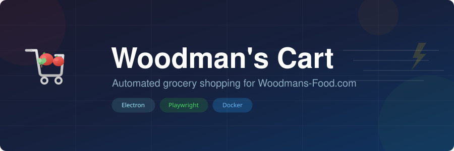

<p align="center">
  
</p>

# Woodman's Cart

Automate your grocery shopping on [Woodmans-Food.com](https://www.woodmans-food.com). Search and add items, manage weekly staples, and send everything to your online cart with one click.

Runs as an **Electron desktop app** or a **standalone web server** (for Docker/Unraid).

## Features

- **Staple Items** &mdash; Maintain a list of weekly essentials that get added to your cart every time
- **Product Search** &mdash; Search the Woodman's catalog and link exact products to your items
- **One-Click Cart** &mdash; Adds all enabled items to your Woodmans-Food.com cart automatically
- **Two Automation Modes**
  - *Standard* &mdash; Full Playwright browser automation (~3-5s per item)
  - *Fast* &mdash; Direct GraphQL API calls (~10x faster)
- **Dark Mode** &mdash; Because of course
- **Mobile-Friendly** &mdash; Works as a home screen web app on iOS/Android when running in server mode
- **In-Store Shopping Mode** &mdash; Turn the Woodman's cart into a phone-friendly walking list, ordered for the Racine store, with a timer, trip history, and a PDF

## Shopping Mode

After the items are in the Woodman's cart, Shopping Mode is the list you actually walk with. It is built for a phone in the Racine store.

1. Set the badge in the header to **In-Store**. Aisle labels only come back for that shop. Pickup carts leave the location blank.
2. Open **Woodmans Cart** and tap **Refresh** so the app reads the live cart, including each item's aisle.
3. Tap **Shop in Store**. The screen is only the list: photo, aisle, quantity, and a row you tap anywhere to cross off. A second tap clears the line. Checked items stay in walk order. **Compact** fits about twice as many items on a phone; **Comfortable** gives the rows more room. The choice is remembered on that phone. The list fills the screen in portrait and landscape, including under the notch.
4. Tap **Start Shopping** when you walk in. The timer runs until **End Shopping**, which saves the trip.
5. Checked rows drop into a tray at the bottom. The header shows progress, like **8 of 25**. Closing the screen or locking the phone does not clear those checks. They are stored in `data/active-trip.json`.

The walk order is the Racine default: Produce, Floral, Bakery, Deli, Cheese, Meat & Seafood, numbered aisles from low to high, then Dairy, Frozen, the Soda Wall, Liquor, Health & Beauty, and Other. Items with no location go in Other, at the end. Shelves inside a group go in order (A before B, then the number). Tap **Aisles** on the shopping screen to move sections, split the numbered aisles into ranges, or match a department word Instacart uses (for example `soda` matches "Soda Wall"). **Reset to Racine default** puts the original walk back.

**Trips** keeps every finished trip: date, duration, cart total, and how many items were checked versus skipped. The charts compare the last eight weeks on time, spend, and seconds per item. The total is the sum of the prices on the list, not the Instacart receipt. History is `data/shopping-trips.json`. Both files live in the data directory, so the Docker volume keeps them across restarts. There is nothing new to configure.

**PDF** exports the same walk order with a thumbnail, the aisle, the quantity, and a real checkbox on each row. Those checkboxes are AcroForm fields, so a PDF app that supports forms (Adobe Acrobat, PDF Expert) lets you tap them. Other viewers still show the box.

On an iPhone, open the site in Safari, tap Share, then **Add to Home Screen**. The app ships a web manifest and icons, and it asks the screen to stay awake while Shopping Mode is open (Safari 16.4 or newer; Low Power Mode can still dim it). Shopping Mode fills the screen in Safari and as a home-screen app, including under the notch and above the home indicator. Pinch-zoom is off so a tap does not zoom the list.

## Quick Start

### Desktop (Electron)

```bash
npm install
npm run setup       # downloads Chromium for Playwright
npm start
```

### Docker

```bash
docker build -t woodmans-cart .
docker run -d \
  -p 3456:3456 \
  -e WOODMANS_USERNAME=you@email.com \
  -e WOODMANS_PASSWORD=yourpassword \
  -v woodmans-data:/app/data \
  woodmans-cart
```

Then open `http://localhost:3456` in your browser. Keep the `/app/data` volume mounted. Shopping trips, the in-progress list, and a custom walk order are saved there with the rest of the app data, so a container restart does not drop them.

To pick up this feature on an existing Unraid or Docker install: rebuild or pull the image, recreate the container, and leave the same data volume attached. No new environment variables are required. On your phone, refresh the in-store cart once so aisle labels are filled in, then use Shop in Store.

### Environment Variables (Docker)

| Variable | Description |
|----------|-------------|
| `WOODMANS_USERNAME` | Woodmans-Food.com login email |
| `WOODMANS_PASSWORD` | Woodmans-Food.com password |

## How It Works

1. **Configure** your Woodman's credentials in Settings
2. **Add staples** &mdash; your recurring weekly items
3. **Search and add items** &mdash; build this trip's cart from the Add Items search
4. **Hit "Add to Cart"** &mdash; the app logs into Woodmans-Food.com and adds everything automatically
5. **Shop in Store** &mdash; refresh the in-store cart and walk the list on your phone

In **Standard mode**, Playwright drives a real browser through the checkout flow. In **Fast mode**, it logs in once to grab session cookies, then fires GraphQL API calls directly &mdash; much faster but dependent on Instacart's API stability.

## Architecture

```
Electron (main.js)  ─┐
                      ├─► server.js (Express + WebSocket, port 3456)
Docker (server-standalone.js) ─┘
                                    │
                         ┌──────────┴──────────┐
                    cart-worker.js        cart-worker-fast.js
                   (Playwright browser)    (GraphQL API)
                         └──────────┬──────────┘
                                    │
                            Woodmans-Food.com
```

The renderer is a vanilla HTML/CSS/JS SPA with no build step. An [API adapter](renderer/api-adapter.js) transparently routes calls through Electron IPC or REST+WebSocket depending on the environment.

## Tech Stack

- **Electron** &mdash; Desktop shell
- **Express + WebSocket** &mdash; Server and real-time updates
- **Playwright** &mdash; Browser automation
- **Vanilla JS** &mdash; No framework, no build step

## License

MIT
